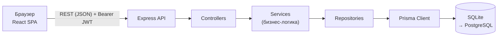

# Архитектура FitHome

> Статус: Этап 1 — подготовка архитектуры. Документ является источником истины для структуры проекта.

## 1. Общая схема

FitHome — монорепозиторий из двух независимых приложений: SPA-клиента и API-сервера. Клиент не обращается к базе данных напрямую — весь обмен данными идёт через REST API с JWT-авторизацией.



### Ключевые решения

| Решение | Выбор | Обоснование |
|---|---|---|
| Взаимодействие клиент↔сервер | REST + JSON | Простая интеграция, предсказуемые контракты (см. [api.md](api.md)) |
| Монорепозиторий | Два пакета npm без Nx/Turborepo | Два приложения, а не библиотека общих модулей — сборщики-оркестраторы избыточны |
| Авторизация | JWT (access в памяти, refresh в httpOnly cookie) | Stateless-сервер, готовность к масштабированию; refresh-токен защищён от XSS |
| Доступ к данным | Prisma + слой repositories | Прямые обращения к Prisma только в repositories — смена СУБД не затрагивает бизнес-логику |
| Валидация | Схемы на входе контроллеров | Контракт на границе HTTP; единый формат ошибок |
| Стили | Чистый CSS + переменные `:root` | Ноль зависимостей, полный контроль, лёгкий переход на CSS Modules при росте |

## 2. Структура репозитория

```
FitHome/
├── docs/                  # Техническая документация (источник истины)
├── backend/               # API-сервер
│   ├── prisma/
│   │   └── schema.prisma  # Схема БД — 7 сущностей (см. database.md)
│   ├── src/
│   │   ├── config/        # Чтение и валидация переменных окружения
│   │   ├── routes/        # Маршруты Express (тонкий слой: путь → controller)
│   │   ├── controllers/   # HTTP-обработчики: валидация входа, вызов service, статус-коды
│   │   ├── services/      # Бизнес-логика (не знает про HTTP)
│   │   ├── repositories/  # Доступ к данным через Prisma (не знает про бизнес-правила)
│   │   ├── middlewares/   # auth (JWT), validation, error-handler
│   │   ├── types/         # Общие типы: DTO, ошибки домена
│   │   ├── app.ts         # Сборка Express-приложения (без прослушивания порта — для тестов)
│   │   └── server.ts      # Точка входа: запуск HTTP-сервера
│   ├── .env.example
│   └── package.json
└── frontend/              # SPA-клиент
    ├── src/
    │   ├── api/           # HTTP-клиент (fetch, авторизация, обработка ошибок)
    │   ├── services/      # Работа с токенами и auth-состоянием
    │   ├── pages/         # Экраны приложения
    │   ├── components/    # Переиспользуемые UI-компоненты
    │   ├── hooks/         # Кастомные React-хуки
    │   ├── context/       # React Context (auth и др.)
    │   ├── types/         # Типы, зеркалящие DTO backend
    │   ├── styles/        # CSS-переменные и базовые стили (см. design.md)
    │   ├── App.tsx        # Корневой компонент
    │   └── main.tsx       # Точка входа
    ├── index.html
    └── package.json
```

## 3. Слои backend и правило зависимостей

Зависимости направлены строго вниз — слой выше знает о слое ниже, но не наоборот:

```
routes → controllers → services → repositories → Prisma
```

| Слой | Ответственность | Запрещено |
|---|---|---|
| `routes` | Регистрация путей и middleware | Бизнес-логика, доступ к данным |
| `controllers` | Валидация входа, формат ответа, статус-коды | Обращения к Prisma, правила домена |
| `services` | Бизнес-логика: права доступа, расчёты, транзакции | Знание о HTTP (req/res, статус-коды) |
| `repositories` | CRUD через Prisma | Бизнес-правила |
| `middlewares` | Аутентификация, обработка ошибок | Знание конкретных доменов |

Доменные ошибки (`types/errors.ts`) выбрасываются в `services` и преобразуются в HTTP-ответы единым `error-handler` middleware — формат ошибок описан в [api.md](api.md).

## 4. Слои frontend

| Слой | Ответственность |
|---|---|
| `api/` | Единственное место, где делается `fetch`: подстановка base URL, Bearer-токена, разбор ошибок |
| `services/` | Токены, auth-состояние, преобразование DTO в модели |
| `context/` | Глобальное состояние (auth), доступное через хук |
| `hooks/` | Переиспользуемое поведение (загрузка данных и др.) |
| `pages/` | Экраны — композиция компонентов, не содержит HTTP-кода |
| `components/` | Чистые презентационные компоненты |

## 5. Авторизация (JWT)

- **Access-токен**: срок жизни 15 минут, хранится в памяти SPA, передаётся в заголовке `Authorization: Bearer <token>`.
- **Refresh-токен**: срок жизни 30 дней, opaque-строка в httpOnly + SameSite=Lax cookie (`Path=/api/auth`; флаг `Secure` — в production), ротация при каждом обновлении. В БД (модель `RefreshToken`, [database.md §2.8](database.md#28-refreshtoken--refresh-сессия-добавлено-на-этапе-2)) хранится только SHA-256-хеш; повторное использование отозванного токена отзывает все сессии пользователя.
- `/api/auth/refresh` — единственный публичный эндпоинт, использующий cookie.
- Пароли: bcrypt (cost 10). Секреты — только из переменных окружения (см. `backend/.env.example`).
- CORS с credentials: SPA (:5173) и API (:4000) — разные origin; разрешённый origin задаётся `CORS_ORIGIN`.

## 6. Готовность к переходу SQLite → PostgreSQL

1. Провайдер задаётся одной строкой `provider` в `prisma/schema.prisma` и переменной `DATABASE_URL` — смене подлежат только они.
2. Обращения к Prisma изолированы в `repositories` — слой не зависит от СУБД.
3. Типы полей совместимы с PostgreSQL: `String` для перечислений, `DateTime`, `Decimal` для весов, `Int` для счётчиков; автоинкремент — `autoincrement()`.
4. Сырые SQL-запросы запрещены (правило code review); миграции создаются через `prisma migrate`.
5. В `docker-compose.yml` (добавляется на этапе перехода) поднимается PostgreSQL, меняется `DATABASE_URL`, выполняется `prisma migrate deploy`.

Подробности — в [database.md](database.md#8-стратегия-перехода-sqlite--postgresql).

## 7. Конфигурация окружения

| Переменная | Где | Назначение |
|---|---|---|
| `PORT` | backend | Порт API (по умолчанию 4000) |
| `DATABASE_URL` | backend | Строка подключения (SQLite: `file:./dev.db`) |
| `JWT_ACCESS_SECRET` | backend | Секрет подписи access-токенов |
| `JWT_REFRESH_SECRET` | backend | Секрет подписи refresh-токенов |
| `CORS_ORIGIN` | backend | Origin SPA для CORS с credentials (по умолчанию `http://localhost:5173`) |
| `VITE_API_BASE_URL` | frontend | Базовый URL API (по умолчанию `http://localhost:4000`) |

`config/env.ts` валидирует обязательные переменные при старте — приложение не поднимается с некорректной конфигурацией.

## 8. Конвенции

- Нейминг файлов: `PascalCase` — компоненты React и типы; `camelCase` — модули backend и хуки; `kebab-case` — документация.
- Комментарии в коде и документация — на русском языке, идентификаторы — на английском.
- Каждый эндпоинт, поле БД и экран интерфейса сначала описываются в `docs/`, затем реализуются.

## 9. План развития (этапы 2+)

1. **Этап 2** — авторизация: Users, JWT, middlewares, страницы Login/Register.
2. **Этап 3** — каталог упражнений и программы: Exercises, Programs, ProgramExercises.
3. **Этап 4** — тренировки и результаты: Workouts, WorkoutResults, статистика.
4. **Этап 5** — настройки пользователя: UserSettings, темы, единицы измерения.
5. **Этап 6** — переход на PostgreSQL, деплой.
