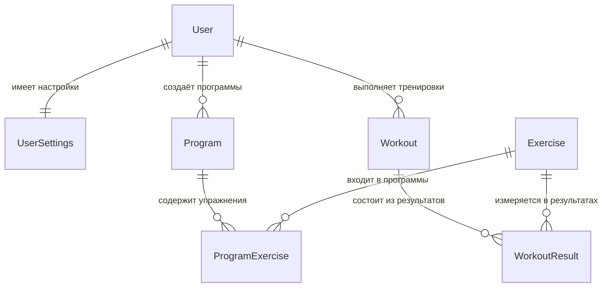

# Схема базы данных FitHome

> Статус: Этап 1 — предварительная схема. Канонический источник — `backend/prisma/schema.prisma`; документ описывает те же сущности и связи.

## 1. Обзор

База данных состоит из **7 сущностей** и покрывает три домена: пользователи и настройки, каталог упражнений и программы, тренировки и результаты.

## 2. Сущности

### 2.1. User — пользователь

Учётная запись. Пароль хранится только в виде bcrypt-хеша.

| Поле | Тип | Constraints | Описание |
|---|---|---|---|
| `id` | Int | PK, autoincrement | Идентификатор |
| `email` | String | unique, not null | Email (логин), в нижнем регистре |
| `passwordHash` | String | not null | bcrypt-хеш пароля (cost 10) |
| `name` | String | not null | Отображаемое имя |
| `createdAt` | DateTime | not null, default now | Дата регистрации |
| `updatedAt` | DateTime | auto-updated | Дата изменения |

Связи: `settings` (1—1 UserSettings), `programs` (1—N Program), `workouts` (1—N Workout).

### 2.2. UserSettings — настройки пользователя

Ровно одна запись на пользователя (создаётся вместе с пользователем).

| Поле | Тип | Constraints | Описание |
|---|---|---|---|
| `id` | Int | PK, autoincrement | Идентификатор |
| `userId` | Int | unique, FK → User, not null | Пользователь (1—1) |
| `unit` | String | not null, default `"kg"` | Единицы веса: `kg` \| `lb` |
| `theme` | String | not null, default `"system"` | Тема: `light` \| `dark` \| `system` |
| `reminderTime` | String | nullable | Время напоминания `HH:mm` (локальное) |
| `reminderEnabled` | Boolean | not null, default false | Включены ли напоминания |

Перечисления хранятся строками (не Enum Prisma) — осознанное решение для совместимости с PostgreSQL и простоты миграции значений.

### 2.3. Exercise — упражнение

Каталог упражнений. Приложение поставляет базовый набор (общие упражнения), пользователь может добавлять свои (персональные).

| Поле | Тип | Constraints | Описание |
|---|---|---|---|
| `id` | Int | PK, autoincrement | Идентификатор |
| `name` | String | not null | Название («Отжимания», «Приседания») |
| `nameLower` | String | not null | Название в нижнем регистре для кириллического поиска (JS `toLowerCase` — SQL `lower()` в SQLite обрабатывает только ASCII, см. [stage0](stage0-experiments.md)) |
| `description` | String | nullable | Описание и техника выполнения |
| `place` | String | not null | Место выполнения: `home` \| `outdoor` \| `gym` |
| `metric` | String | not null | Метрика результата: `reps` (повторы) \| `reps_weight` (повторы + вес) \| `time` (секунды) |
| `muscleGroups` | String | not null | Канонический CSV с ограничивающими запятыми: `",chest,triceps,"` — фильтры API проверяют точное совпадение целого токена (`contains ",chest,"`), substring-совпадение исключено |
| `difficulty` | String | not null | Сложность: `easy` \| `medium` \| `hard` |
| `equipment` | String | nullable | Канонический CSV инвентаря (`",dumbbell,bench,"`) или null — без инвентаря |
| `userId` | Int | nullable, FK → User | null — общее упражнение; задан — персональное упражнение пользователя |
| `createdAt` | DateTime | not null, default now | Дата создания |

Индексы: `@@index([place])`, `@@index([userId])`, `@@unique([userId, name])`. Индекс на `nameLower` не требуется
при текущих объёмах (см. §7); `@@unique([userId, name])` в SQLite не дедуплицирует строки с `userId = null` —
идемпотентность общих упражнений обеспечивает seed (findFirst).

Нормализация (единая реализация — `backend/prisma/stage3/normalize.ts`): trim → lowercase; CSV-токены:
trim, lowercase, пробел внутри токена → `_`, удаление пустых и дубликатов, сборка с ограничивающими запятыми;
неизвестные (вне словаря) токены сохраняются.

### 2.4. Program — программа тренировок

План: упорядоченный набор упражнений с целевыми нагрузками. Либо программа пользователя,
либо готовая программа каталога.

| Поле | Тип | Constraints | Описание |
|---|---|---|---|
| `id` | Int | PK, autoincrement | Идентификатор |
| `userId` | Int | nullable, FK → User | null — **готовая программа каталога** (общедоступна, read-only); задан — владелец |
| `name` | String | not null | Название («Ключевой курс») |
| `description` | String | nullable | Описание и цели программы |
| `place` | String | not null | Контекст: `home` \| `outdoor` \| `gym` |
| `isActive` | Boolean | not null, default true | Активна ли программа (не удалена) |
| `createdAt` | DateTime | not null, default now | Дата создания |
| `updatedAt` | DateTime | auto-updated | Дата изменения |

Индексы: `@@index([userId, isActive])`.

Удаление — soft delete через `isActive` (история тренировок ссылается на программу).

### 2.5. ProgramExercise — упражнение в программе

Связующая сущность N—M: состав программы с целевыми нагрузками.

| Поле | Тип | Constraints | Описание |
|---|---|---|---|
| `id` | Int | PK, autoincrement | Идентификатор |
| `programId` | Int | FK → Program, not null | Программа (cascade delete) |
| `exerciseId` | Int | FK → Exercise, not null | Упражнение |
| `order` | Int | not null | Порядок выполнения в программе (с 1) |
| `targetSets` | Int | not null, default 3 | Целевое число подходов |
| `targetReps` | Int | nullable | Целевое число повторов |
| `targetWeight` | Decimal | nullable | Целевая весовая нагрузка |
| `targetDuration` | Int | nullable | Целевая длительность подхода, сек (для метрики `time`) |
| `restSec` | Int | not null, default 90 | Перерыв между подходами, сек (`0` — без перерыва) |

Индексы: `@@unique([programId, order])`, `@@index([exerciseId])`.

Заполненность целевых полей определяется метрикой упражнения (`Exercise.metric`).

### 2.6. Workout — тренировка

Одна выполненная тренировка пользователя: факт прохождения программы (или свободной тренировки — тогда `programId` равен null).

| Поле | Тип | Constraints | Описание |
|---|---|---|---|
| `id` | Int | PK, autoincrement | Идентификатор |
| `userId` | Int | FK → User, not null | Пользователь |
| `programId` | Int | nullable, FK → Program | Программа; null — свободная тренировка |
| `place` | String | not null | Место: `home` \| `outdoor` \| `gym` |
| `performedAt` | DateTime | not null, default now | Дата и время тренировки |
| `notes` | String | nullable | Заметки о тренировке |
| `createdAt` | DateTime | not null, default now | Дата создания записи |

Индексы: `@@index([userId, performedAt])` — для истории и статистики.

### 2.7. WorkoutResult — результат упражнения в тренировке

Строка результата по одному упражнению в рамках тренировки.

| Поле | Тип | Constraints | Описание |
|---|---|---|---|
| `id` | Int | PK, autoincrement | Идентификатор |
| `workoutId` | Int | FK → Workout, not null | Тренировка (cascade delete) |
| `exerciseId` | Int | FK → Exercise, not null | Упражнение |
| `sets` | Int | not null | Фактически выполнено подходов |
| `reps` | Int | nullable | Повторов за подход / всего |
| `weight` | Decimal | nullable | Вес нагрузки |
| `duration` | Int | nullable | Длительность, сек |
| `notes` | String | nullable | Заметки к результату |

Индексы: `@@index([workoutId])`, `@@index([exerciseId])`.

## 3. Правила целостности

| Правило | Реализация |
|---|---|
| 1 пользователь — 1 настройки | `UserSettings.userId` unique; создаются каскадом при регистрации (service) |
| Пользователь видит только свои программы/тренировки | Проверка `userId` на уровне services (см. [architecture.md](architecture.md#3-слои-backend-и-правило-зависимостей)) |
| Удаление пользователя | Каскад: Program, Workout, UserSettings; общие Exercise сохраняются (userId nullable) |
| Удаление программы | Каскад: ProgramExercise; Workout.programId обнуляется (`onDelete: SetNull`) — история сохраняется |
| Удаление упражнения | WorkoutResult.exerciseId и ProgramExercise.exerciseId — `onDelete: Restrict`: запретить удаление, если есть результаты/программы |
| Удаление тренировки | Каскад: WorkoutResult |
| Названия упражнений пользователя уникальны | `@@unique([userId, name])` (общие проверяются на уровне service) |
| Целевые поля ProgramExercise соответствуют метрике | Проверка на уровне services (`metric === 'time'` → заполнен `targetDuration` и т.д.) |
| Refresh-токен не хранится в открытом виде | В `RefreshToken.tokenHash` — только SHA-256-хеш; повторное использование отозванного токена отзывает все сессии пользователя |
| 1 пользователь — много refresh-сессий | `RefreshToken.userId` FK → User (cascade delete) |

## 4. Соответствие документации и Prisma

Каноническая схема хранится в [`backend/prisma/schema.prisma`](../backend/prisma/schema.prisma). Таблицы выше и модель Prisma должны быть синхронны; при изменении схемы правятся оба файла в одном коммите.

## 5. Согласованность с API

Все эндпоинты [api.md](api.md) работают только с перечисленными сущностями и полями. Например: `POST /api/auth/register` создаёт `User` + `UserSettings`; `POST /api/workouts` создаёт `Workout` и связанные `WorkoutResult` одной транзакцией.

## 6. Индексация — сводка

| Сущность | Индексы | Для чего |
|---|---|---|
| User | unique `email` | Вход |
| Exercise | `place`, `userId`, unique `(userId, name)` | Фильтр по месту, персональные, дубликаты |
| Program | `(userId, isActive)` | Список активных программ пользователя |
| ProgramExercise | unique `(programId, order)`, `exerciseId` | Упорядоченный состав |
| Workout | `(userId, performedAt)` | История и статистика по датам |
| WorkoutResult | `workoutId`, `exerciseId` | Выборка результатов тренировки, прогресс упражнения |

### 2.8. RefreshToken — refresh-сессия (добавлено на этапе 2)

Сессия авторизации: в БД хранится только SHA-256-хеш refresh-токена — утечка базы не раскрывает действующие токены. Ротация: при каждом `/api/auth/refresh` старая запись помечается `revokedAt` и создаётся новая. Повторное использование отозванного токена — сигнал компрометации: отзываются все сессии пользователя.

| Поле | Тип | Constraints | Описание |
|---|---|---|---|
| `id` | Int | PK, autoincrement | Идентификатор |
| `userId` | Int | FK → User, not null | Владелец сессии (cascade delete) |
| `tokenHash` | String | unique, not null | SHA-256-хеш refresh-токена |
| `expiresAt` | DateTime | not null | Момент истечения (30 дней с выдачи) |
| `createdAt` | DateTime | not null, default now | Момент выдачи |
| `revokedAt` | DateTime | nullable | Момент ротации/выхода; не null — сессия отозвана |

Индексы: `@@index([userId])`, unique `tokenHash`.

## 7. Объёмы данных (оценка)

Ожидаемые объёмы на одного пользователя (год активного использования): ~200 тренировок × ~6 результатов ≈ 1200 строк WorkoutResult, ~10–30 программ, ~50–100 персональных упражнений. Для сотен пользователей SQLite покрывает нагрузку; переход на PostgreSQL выполняется по плану ниже при росте или росте конкурентной записи.

## 8. Миграция этапа 3 и seed — процедура

Этап 3 добавляет колонки `nameLower`/`difficulty`/`equipment` в `exercises` и делает
`programs.userId` nullable. Последовательность построена на результатах Шага 0
([stage0-experiments.md](stage0-experiments.md)).

**Миграции:**
- `20261112000000_stage3_add_columns` (A) — nullable-колонки, безопасна на любой БД;
- `20261112000100_stage3_exercises_programs_rebuild` (B) — rebuild `exercises` и
  `programs` с парковочным DDL для дочерних таблиц (`program_exercises`, `workout_results`,
  `workouts`) — Prisma Migrate 6.19.3 исполняет миграции с немедленной FK-проверкой
  (`defer_foreign_keys` в его контексте не действует), поэтому DROP родителя возможен
  только без детей. B защищён NOT NULL-guard'ом: `INSERT SELECT` копирует уже
  заполненный JS-backfill'ом `nameLower` — на незаполненной базе миграция падает
  ДО удаления данных.

**Порядок (оркестратор `npm run stage3:migrate`, цель — переменная `STAGE3_DATABASE_URL`):**

| База | Поведение |
|---|---|
| Свежая/пустая | `deploy` применяет A и B одним запуском (B на пустой таблице безопасен), затем `npm run db:seed` |
| С данными | `deploy`: A применяется, B безопасно падает (guard) → recovery: возврат детей из парковок `_pe_park`/`_wr_park`/`_w_park`, удаление остатков `_new_*` → `db:backfill-stage3` (JS `toLowerCase` для кириллицы) → `db:verify-stage3` → `migrate resolve --rolled-back B` (работает только для failed) → повторный `deploy` → verify |

**Восстановление после сбоя B** (выполняет оркестратор автоматически при подтверждённой
ошибке `1299 NOT NULL constraint failed: _new_exercises.*`; при любой иной ошибке — остановка):
возврат детей из парковок → удаление `_new_*` и парковок → backfill → verify → resolve → deploy.
Проверено интеграционно: `npm run stage3:verify-integration` (сценарии «существующая БД +
recovery» и «свежая БД», идемпотентность seed ×2).

**Идемпотентный seed** (`prisma/seed.ts`, `npm run db:seed`): общие упражнения ищутся по
`userId = null + nameLower`, готовые программы — по `userId = null + name`; существующие записи
не изменяются, недостающие строки состава дополняются. Повторный запуск не создаёт дубликатов
(в SQLite `@@unique([userId, name])` не дедуплицирует NULL-строки — см. §2.3).

## 9. Стратегия перехода SQLite → PostgreSQL

1. **Изоляция доступа** — обращения к Prisma только в `repositories` (см. [architecture.md](architecture.md)).
2. **Совместимые типы** — в схеме нет специфичных для SQLite конструкций: перечисления хранятся строками, автоинкремент через `autoincrement()` (в PostgreSQL → `serial`), Decimal для весов.
3. **Никаких сырых SQL-запросов** — только API Prisma Client; правило закреплено в конвенциях.
4. **Процедура перехода** (этап 6):
   1. Поднимается PostgreSQL (docker-compose).
   2. В `schema.prisma` меняется `provider = "postgresql"`, в `.env` — `DATABASE_URL`.
   3. `npx prisma migrate dev --name init-postgres` создаёт чистую схему.
   4. При необходимости переноса данных — разовый скрипт экспорта/импорта через Prisma (SQLite → PostgreSQL), запускается один раз до открытия доступа пользователям.
   5. `npm test` на backend — smoke-проверка repositories на новой СУБД.
5. **Что меняется в коде: ничего** — слой repositories и services не зависят от провайдера.
